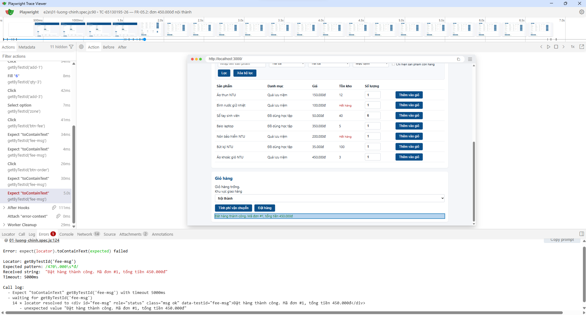

# BUỔI 5 – BÁO CÁO KIỂM THỬ TỰ ĐỘNG GIAO DIỆN

- **Họ tên:** Nguyễn Quốc Bảo
- **MSSV:** 65130195
- **Phiên bản phần mềm:** MiniShop NTU v1.1.0
- **Tài liệu yêu cầu:** SRS v1.2
- **Ngày thực hiện:** 05/11/2026

## 1. Tổng hợp kết quả chạy `npm run e2e`

| Chỉ số | Giá trị |
|---|---|
| Tổng số ca Playwright | 36 |
| Số ca đạt | 30 |
| Số ca thất bại | 5 |
| Số ca bỏ qua | 1 |
| Thời gian chạy toàn bộ | 42,4 giây |

Có 35 ca được thực thi, trong đó 30 ca đạt và 5 ca thất bại. Tỷ lệ đạt trên các ca đã thực thi là 85,7%. Kết quả gồm kiểm thử E2E, API và các ca ví dụ.

Trong riêng thư mục `tests/e2e/`, có 17 ca được thực thi: 12 đạt và 5 thất bại.

So với kiểm thử thủ công ở Buổi 4, Playwright có thể tự động thực hiện lại nhiều kịch bản mà không cần thao tác từng bước bằng tay. Tuy nhiên, báo cáo Buổi 4 không có số liệu thời gian chạy tay cho cùng 17 kịch bản nên chưa thể so sánh chính xác bằng phút.

## 2. Các ca đã tự động hóa ở Phần 1

| Mã ca Buổi 2 | Yêu cầu (SRS v1.2) | Tên ca E2E | Kết quả |
|---|---|---|---|
| TC-65130195-01 | FR-01.3 | Đăng ký với tuổi 17 bị từ chối | Pass |
| TC-65130195-31 | FR-02.3 | Khóa tài khoản sau 3 lần đăng nhập sai | Pass |
| TC-65130195-24 | FR-04.3 | VIP miễn phí vận chuyển ở ngoại thành | Pass |
| TC-65130195-26 | FR-05.2 | Đơn 450.000đ nội thành | Fail |

Ba ca đầu đạt yêu cầu. Ca TC-65130195-26 thất bại vì tổng tiền đặt hàng không cộng phí vận chuyển.

## 3. Lựa chọn locator

| Phần tử | Locator đã dùng | Lý do |
|---|---|---|
| Ô email đăng nhập | `page.getByTestId('login-email')` | Không phụ thuộc nhãn hiển thị hoặc thứ tự phần tử. |
| Nút đăng nhập | `page.getByTestId('btn-login')` | Dùng mã định danh dành riêng cho kiểm thử. |
| Thông báo tính phí | `page.getByTestId('fee-msg')` | Xác định đúng vùng hiển thị kết quả và kết hợp với web-first assertion. |

Nếu đổi nhãn nút "Đăng nhập" thành "Vào hệ thống", những ca đang sử dụng `getByTestId('btn-login')` vẫn hoạt động vì không phụ thuộc vào chữ trên nút.

Nếu đổi `data-testid="btn-login"`, các ca có locator trực tiếp sẽ phải sửa lại. Với những ca sử dụng Page Object Model, chỉ cần cập nhật locator trong `LoginPage.js`.

## 4. Kết quả kiểm thử hồi quy FR-06 (Phần 4)

| Yêu cầu | Tên ca E2E | Kết quả mong đợi | Kết quả thực tế | Pass/Fail |
|---|---|---|---|---|
| FR-06.2 | Tìm kiếm không phân biệt hoa thường | Từ khóa `tHuN` tìm thấy Áo thun NTU | Trả về đúng sản phẩm | Pass |
| FR-06.3 | Lọc danh mục Đồ dùng học tập | Hiển thị đúng 3 sản phẩm | Hiển thị đúng 3 sản phẩm | Pass |
| FR-06.4 | Lọc khoảng giá 100.000–300.000đ | Có 3 sản phẩm trong khoảng giá | Hiển thị đúng 3 sản phẩm | Pass |
| FR-06.5 (tăng dần) | Sắp xếp giá tăng dần | Giá từ thấp đến cao | Đúng thứ tự | Pass |
| FR-06.5 (giảm dần) | Sắp xếp giá giảm dần | Giá từ cao xuống thấp | Vẫn hiển thị giá tăng dần | Fail |
| FR-06.6 | Chỉ hiển thị sản phẩm còn hàng | Chỉ có 5 sản phẩm tồn kho > 0 | Vẫn hiển thị 7 sản phẩm | Fail |
| FR-06.7 | Kết hợp từ khóa, danh mục, tồn kho | Chỉ có Áo thun NTU và Áo khoác gió NTU | Có thêm Nón bảo hiểm NTU đã hết hàng | Fail |
| FR-06.7 | Thông báo khi không có kết quả | "Không tìm thấy sản phẩm phù hợp" | "Không tìm thấy sản phẩm phù hợp." | Fail |

Tổng hợp FR-06: 8 ca kiểm thử, 4 Pass và 4 Fail.

## 5. Phân tích các ca thất bại

| Tên ca E2E | Kết quả mong đợi | Kết quả thực tế | Phân loại | Căn cứ |
|---|---|---|---|---|
| TC-65130195-26 – FR-05.2 | Đơn 450.000đ nội thành có tổng thanh toán 470.000đ | Tổng tiền 450.000đ | LỖI MÃ NGUỒN | FR-05.2 và quy tắc phí vận chuyển |
| FR-06.5 – Giá giảm dần | Giá từ cao xuống thấp | Giá vẫn tăng dần | LỖI MÃ NGUỒN | FR-06.5 |
| FR-06.6 – Chỉ còn hàng | Chỉ hiển thị 5 sản phẩm còn hàng | Hiển thị đủ 7 sản phẩm | LỖI MÃ NGUỒN | FR-06.6 |
| FR-06.7 – Kết hợp bộ lọc | Loại sản phẩm tồn kho bằng 0 | Nón bảo hiểm NTU vẫn xuất hiện | LỖI MÃ NGUỒN | FR-06.6 và FR-06.7 |
| FR-06.7 – Không có kết quả | Nội dung thông báo theo SRS | Có thêm dấu chấm cuối câu | YÊU CẦU CHƯA RÕ | FR-06.7; cần xác nhận có bắt buộc khớp dấu câu hay không |

### 5.1. Đối chiếu với Buổi 4

Báo cáo Buổi 4 ghi nhận:
- Kiểm thử xác nhận F-01 đến F-12: 10 đạt, 2 không đạt (F-03 và F-05).
- Hồi quy Jest: 12 test đạt, nhưng 1 test suite không chạy được do thiếu dữ liệu CSV.
- FR-06: 4/6 ca đạt, 2 ca không đạt.

Hai lỗi đã phát hiện thủ công và tiếp tục được Playwright phát hiện:

**BUG-FR06-01 – Sắp xếp giá giảm dần không đúng**
- Buổi 4: TC-FR06-05 Fail.
- Buổi 5: FR-06.5 giảm dần Fail.
- Issue: https://github.com/quocbao110805/sot357-65130195/issues/8

**BUG-FR06-02 – Lọc sản phẩm còn hàng không đúng**
- Buổi 4: TC-FR06-06 Fail.
- Buổi 5: FR-06.6 Fail; FR-06.7 kết hợp bộ lọc cũng Fail do cùng hiện tượng.
- Issue: https://github.com/quocbao110805/sot357-65130195/issues/9

Lỗi mới được phát hiện trong đợt E2E là TC-65130195-26: tổng tiền đặt hàng không cộng phí vận chuyển. Đây là yêu cầu FR-05.2 mà báo cáo Buổi 4 chưa có bằng chứng kiểm tra.

Ngoài ra, ca FR-06.7 về thông báo không có kết quả phát hiện sai khác dấu câu. Cần phân biệt vấn đề văn bản với lỗi chức năng.

Các vấn đề F-03 (mật khẩu đúng 8 ký tự bị từ chối) và F-05 (thời gian khóa tài khoản 15 giây thay vì 15 phút) được ghi nhận ở Buổi 4 nhưng chưa được bộ E2E Buổi 5 kiểm tra đầy đủ các điều kiện tương ứng. Do đó, chưa thể kết luận hai lỗi này đã được khắc phục.

## 6. Dùng Trace Viewer

Chọn ca thất bại TC-65130195-26, thuộc FR-05.2.

| Mục | Nội dung |
|---|---|
| Ca kiểm thử đã xem | TC-65130195-26 – đơn 450.000đ nội thành |
| Bước nào thất bại | Kiểm tra tổng tiền trong thông báo sau khi nhấn Đặt hàng, dòng 124 |
| Ảnh chụp màn hình cho thấy điều gì | Hệ thống thông báo đặt hàng thành công, mã đơn #1, tổng tiền 450.000đ |
| Thông tin hữu ích trong Trace Viewer | Actions, trạng thái giao diện, thông báo Expected/Received và thời điểm thực hiện thao tác |

Phân tích: tiền hàng là 450.000đ, phí vận chuyển nội thành là 20.000đ. Tổng thanh toán đúng phải là 470.000đ. Trong `src/server.js`, API `POST /api/orders` tính trường `total` chưa cộng phí vận chuyển.

Không sửa mã nguồn để làm ca kiểm thử chuyển sang Pass, vì bài thực hành yêu cầu phát hiện và báo cáo lỗi.

**Ảnh minh chứng:**

## 7. Kết luận

Bộ kiểm thử Playwright đã tự động kiểm tra được các luồng đăng ký, đăng nhập, vận chuyển, đặt hàng, lọc và sắp xếp sản phẩm.

Kết quả chạy toàn bộ: 30/36 Pass, 5 Fail và 1 Skipped. Các ca thất bại cung cấp bằng chứng về những sai lệch giữa MiniShop v1.1.0 và SRS v1.2.

Hai lỗi FR-06 từ Buổi 4 vẫn xuất hiện trong Buổi 5. Ngoài ra, Playwright phát hiện lỗi tính tổng tiền của FR-05.2.

**Đánh giá:** Chưa đủ cơ sở xác nhận MiniShop NTU v1.1.0 đáp ứng toàn bộ các yêu cầu đã kiểm thử. Cần sửa lỗi mã nguồn và chạy hồi quy lại.

**Người thực hiện:** Nguyễn Quốc Bảo
**MSSV:** 65130195